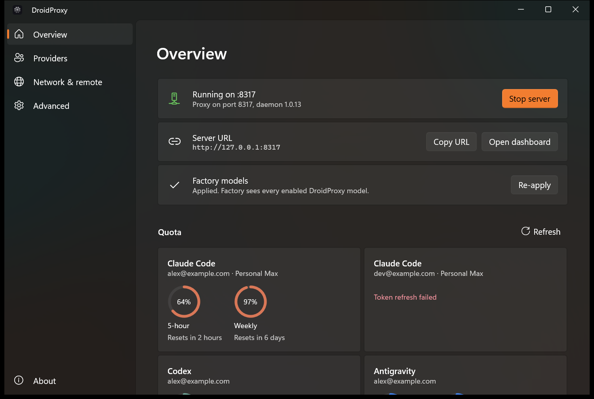
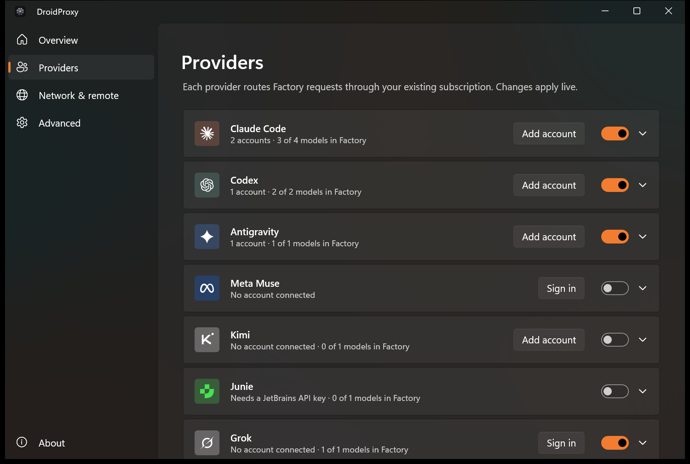
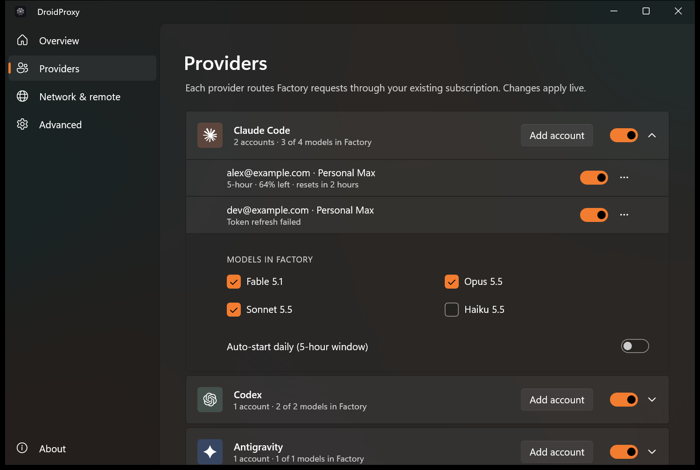
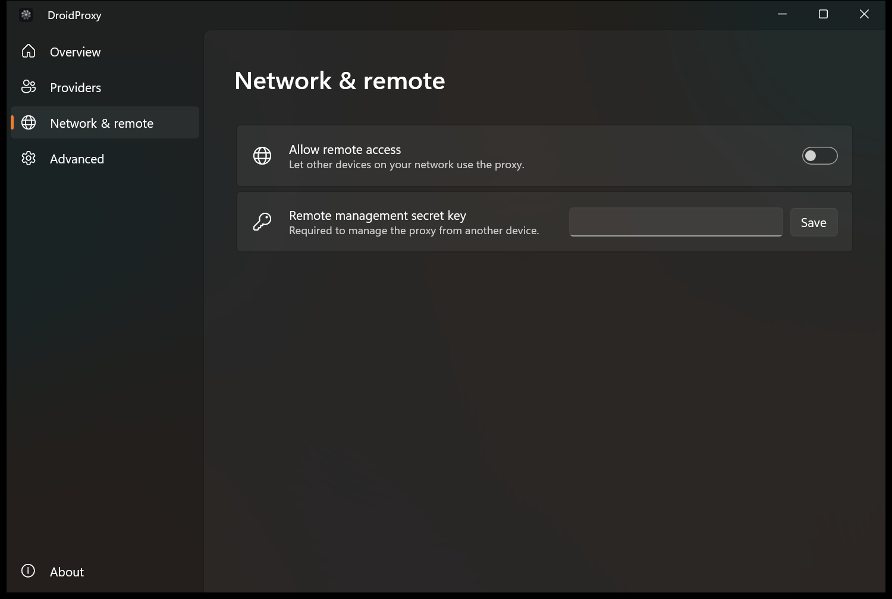

# DroidProxy

<p align="center">
  
</p>

A native macOS menu bar app (with a [Windows preview](#windows-preview)) that proxies Claude Code, Codex, Gemini, Kimi, GitHub Copilot, Junie, and Grok authentication for use with [](https://app.factory.ai) Droids. Built on [CLIProxyAPI](https://github.com/router-for-me/CLIProxyAPI).

https://github.com/user-attachments/assets/d57592a2-3d3e-4ad3-b81a-91da63bb579c

<p align="center">
  
</p>


## Download

Grab the latest release from [Releases](https://github.com/anand-92/droidproxy/releases/latest):

- **DroidProxy-arm64.zip** -- Apple Silicon

Each release also ships a `DroidProxy-arm64.zip.sha256` checksum. Unzip and drag `DroidProxy.app` into your Applications folder. All releases are code-signed and notarized by Apple, and existing installs auto-update via Sparkle.

## Features

- **One-click OAuth auth** -- Claude Code, Codex, Gemini, and Kimi login launched from the Settings window, with credential monitoring and automatic OAuth token refresh.
- **GitHub Copilot** -- Sign in through the Settings window, then select up to three models available to your Copilot subscription. Only those selected models are added to Factory's custom-model configuration.
- **Every model, every reasoning level** -- Fable 5.2, Opus 5.5, Sonnet 4.6, Haiku 5.5, GPT 6 Astra, GPT 6.1 Sol, GPT 6.1 Terra, GPT 6 Luna, Gemini 3 Flash, Kimi K3, and Kimi K2.6 are registered as Factory custom models with their full set of native reasoning levels. Reasoning effort is chosen per session from Droid CLI's model selector; DroidProxy preserves the selection and the bundled backend translates it to each provider's native request format.
- **Fast Mode** -- Optional `service_tier=priority` for GPT 6 Astra, GPT 6.1 Sol, GPT 6.1 Terra, and GPT 6 Luna. Grok 4.7 Fast is a separate SuperGrok model (`grok-4.7-build-fast`).
- **Usage tracking** -- Claude (5-hour + weekly), Codex (whichever of 5-hour, weekly, or monthly the plan has), and SuperGrok (weekly) quota windows rendered as compact ring-gauge cards in the **OAuth Quota Usage** section of the Settings window. Fetched directly from each provider's OAuth API (no `codex` CLI dependency) and refreshed on demand via the inline refresh button.
- **Grok Imagine (image gen)** -- With Grok OAuth connected, DroidProxy also forwards OpenAI-compatible image requests (`POST /v1/images/generations` for `grok-imagine-*` models) to `api.x.ai` — no `XAI_API_KEY`. Factory/Droid does not call that endpoint on its own; use the bundled skill below.
- **GPT Image (Codex OAuth)** -- The bundled skill now prepares GPT Image 2.6 Flare (speed, default) and Sunburst (quality/detail) requests, with opt-in complexity, markup-guided edits, SVG and GIF export. Requests go to `/v1/images/generations` or `/v1/images/edits`, not chat. **The current backend rejects both 2.6 IDs**; OAuth support for their new features is unverified. Older 2.5 models remain explicitly selectable. No `OPENAI_API_KEY`. See [compatibility and proof](skills/gpt-image/COMPATIBILITY.md).

## Setup

See [SETUP.md](SETUP.md) for authentication and manual Factory configuration instructions. **(OR use the 1-click options in the UI!)**

### Image generation skills

If you have **Grok** and/or **Codex** auth set up in DroidProxy, you can generate images through the same proxy. Grab the skills from this repo:

```bash
# From a clone of this repo, copy into your personal Factory skills
mkdir -p ~/.factory/skills
cp -R skills/grok-imagine ~/.factory/skills/
cp -R skills/gpt-image ~/.factory/skills/
```

Copy the whole GPT skill directory, including its dependency-free Bun helper in `scripts/`. See [`skills/grok-imagine/SKILL.md`](skills/grok-imagine/SKILL.md) and [`skills/gpt-image/SKILL.md`](skills/gpt-image/SKILL.md).

Then in Droid, ask to generate an image (or invoke the skill). Both skills post to `http://localhost:8317/v1/images/generations` with `Authorization: Bearer dummy-not-used`:

- **Grok** — model `grok-imagine-image-2.0`; ThinkingProxy injects your Grok OAuth token and forwards to xAI.
- **GPT** — default `gpt-image-2.6-flare`, or `gpt-image-2.6-sunburst` for detailed work. Until CLIProxyAPI accepts them, explicitly set `GPT_IMAGE_MODEL=gpt-image-2.5-flare` or `gpt-image-2.5-sunburst` for raster work. CLIProxyAPI injects Codex OAuth; older backends require Plus/Pro. The 2.6 all-tier announcement does not verify this backend's access.

**Requirements:** Windows 10 1809 or later, or Windows 11, on x64. The app ships the Windows App SDK 2.6.5 runtime in its own folder, and the installer installs the [.NET 10 Desktop Runtime](https://dotnet.microsoft.com/download/dotnet/10.0) when it is missing.

## Requirements

- macOS 13.0+ (Ventura or later)
- Apple Silicon 

## Build from source

The Swift package lives in `src/`, so run `swift` commands from there.

```bash
# Debug build
cd src && swift build

# Release build + signed .app bundle (run from the repo root)
./create-app-bundle.sh

# Preferred dev loop: rebuild the signed .app and relaunch it
./dev-relaunch.sh
```

See [AGENTS.md](AGENTS.md) for the full build, notarization, and release workflow.

## Windows (preview)

A native WinUI 3 app in [`windows/`](windows/) runs the same Go daemon as the [Omarchy build](https://github.com/nikships/droidproxy-omarchy) and manages it from a settings window and the tray. It handles Claude Code, Codex, Antigravity, Meta Muse, Kimi, Junie, and Grok accounts, Factory models, quota rings, and remote access. GitHub Copilot is not supported on Windows yet.

<p align="center">
  
  
</p>
<p align="center">
  
  
</p>

**Requirements:** Windows 10 1809 or later, or Windows 11, on x64, with the [.NET 10 Desktop Runtime](https://dotnet.microsoft.com/download/dotnet/10.0) and the [Windows App Runtime](https://learn.microsoft.com/windows/apps/windows-app-sdk/downloads) 2.6 release, version 2.6.5.0 or newer. That is what the app's Windows App SDK 2.6.5 bootstrapper asks for: release `0x00020006` with a minimum package version of `2.6.5.0`, from `WindowsAppSDK-VersionInfo.cs` in the `Microsoft.WindowsAppSDK.Runtime` package. The app is framework-dependent: the installer installs the .NET 10 Desktop Runtime when it is missing, but not the Windows App Runtime.

**Install:** download `nikships.DroidProxy-win-Setup.exe` from the [`windows-latest` release](https://github.com/nikships/droidproxy/releases/tag/windows-latest) and run it. It installs for the current user into `%LOCALAPPDATA%\nikships.DroidProxy`, with no admin prompt, and adds Start menu and desktop shortcuts. The installer is not code-signed, so SmartScreen warns first: choose **More info**, then **Run anyway**. Closing the window keeps it in the tray. Use **Quit** there to stop the app and the daemon. **Launch at login** in Advanced adds a per-user Run entry for the installed launcher. Uninstall from **Settings > Apps**; accounts and settings in `~\.cli-proxy-api`, `~\.factory` and `~\.local\state\droidproxy` stay.

**Updates:** the installed app checks the `windows-latest` release at launch and then daily, downloads a new version in the background (a delta when it can), and installs it when you choose **Restart to update** in About or **Quit** from the tray. It stops the daemon before the update is applied.

**Build from source:** you need the [.NET 10 SDK](https://dotnet.microsoft.com/download/dotnet/10.0), [PowerShell 7](https://learn.microsoft.com/powershell/scripting/install/installing-powershell-on-windows) (`pwsh`), and [Go](https://go.dev/dl/) for the daemon. Run these from the repository root.

```powershell
dotnet build windows/DroidProxy -c Debug -p:Platform=x64
dotnet test windows

# Package: publishes the app, copies in a Windows daemon tree and runs Velopack
dotnet tool install -g vpk --version 1.2.161
pwsh windows/package.ps1 -DaemonRoot <daemon-tree> -Version 0.1.0
```

This writes the installer, update packages and `releases.win.json` to `DroidProxy-Windows/`, which git ignores. To release, run the **Windows Release** workflow from the Actions tab with a version higher than the last one. It builds the daemon tree and uploads everything to the `windows-latest` release, which the installed app updates from. Every Windows release goes to that one release because Velopack's GitHub source reads only the newest ten releases, and the Mac releases would push Windows ones out.

The daemon tree is a folder with three files:

- `bin\droidproxy.exe`: the Go daemon from [droidproxy-omarchy](https://github.com/nikships/droidproxy-omarchy). Its `main` branch does not build for Windows yet; build `./cmd/droidproxy` with `GOOS=windows GOARCH=amd64` from the branch in [droidproxy-omarchy#13](https://github.com/nikships/droidproxy-omarchy/pull/13).
- `libexec\cli-proxy-api.exe`: from the `windows_amd64` zip of the [CLIProxyAPI release](https://github.com/router-for-me/CLIProxyAPI/releases) named in that repo's `CLIPROXYAPI_VERSION`.
- `share\config.yaml`: that repo's `packaging/config.yaml`.

For UI work without a daemon or real accounts, run the fake daemon in [`windows/tools/`](windows/tools/README.md). [`windows/DroidProxy/AGENTS.md`](windows/DroidProxy/AGENTS.md) describes the layout.

**Known limitations:** unsigned, x64 only so far. Starting a second copy exits quietly instead of focusing the first. **Cancel sign-in** needs the daemon from [droidproxy-omarchy#13](https://github.com/nikships/droidproxy-omarchy/pull/13), which stops the login helper on Windows; older daemon builds could not.

## Project Structure

```
src/
├── Sources/
│   ├── main.swift                   # NSApplication entry point
│   ├── AppDelegate.swift            # App lifecycle, menu bar, settings window, Sparkle updater
│   ├── ServerManager.swift          # cli-proxy-api process control, config merge, auth flows
│   ├── ThinkingProxy.swift          # TCP proxy on :8317 (Anthropic-Beta rewrite, fast mode, Gemini path rewrite)
│   ├── SettingsView.swift           # SwiftUI settings UI
│   ├── DroidProxyModelCatalog.swift # Authoritative catalog of exposed Factory models
│   ├── AuthStatus.swift             # AuthManager: account parsing, expiry, enable/disable
│   ├── AuthDirectoryMonitor.swift   # Debounced watcher on ~/.cli-proxy-api
│   ├── AuthPaths.swift              # Auth directory location constant
│   ├── AppPreferences.swift         # UserDefaults-backed preferences
│   ├── OAuthUsageTracker.swift      # OAuth quota windows for SettingsView
│   ├── OAuthUsageViews.swift        # Compact ring-gauge quota cards
│   ├── CopilotSupport.swift          # Local Copilot API gateway, device login, and selected-model persistence
│   ├── IconCatalog.swift            # NSImage caching for menu-bar / settings icons
│   ├── NotificationNames.swift      # Shared Notification.Name constants
│   ├── LogoView.swift               # Inline-SVG logo used in the settings UI
│   └── Resources/
│       ├── cli-proxy-api            # Bundled CLIProxyAPI binary
│       ├── config.yaml              # Server config (port 8318, localhost)
│       ├── AppIcon.icns             # App icon
│       ├── icon-active.png          # Menu bar icon (active)
│       ├── icon-inactive.png        # Menu bar icon (inactive)
│       ├── icon-claude.png          # Claude service icon
│       ├── icon-codex.png           # Codex service icon
│       ├── icon-copilot.png         # GitHub Copilot service icon
│       ├── icon-gemini.png          # Gemini service icon
│       ├── icon-kimi.svg            # Kimi service icon
│       └── glyph.png                # App glyph
├── Package.swift
├── Package.resolved
└── Info.plist
```

> See [AGENTS.md](AGENTS.md) for a per-file breakdown of what each source file does.

## Stargazers over time
[](https://starchart.cc/anand-92/droidproxy)
## License

MIT
